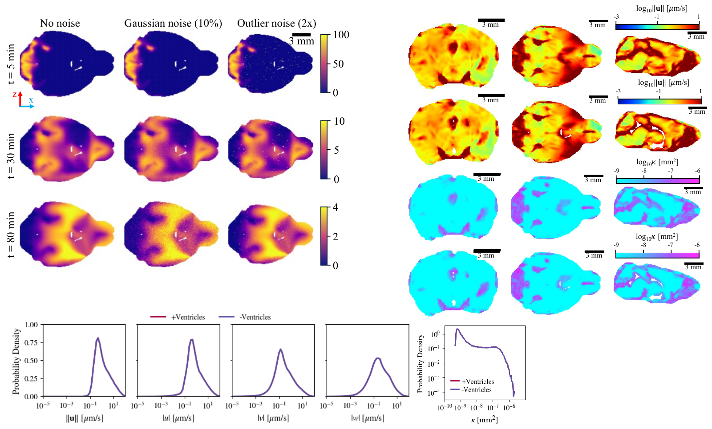
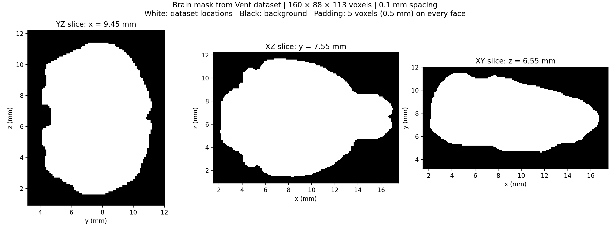
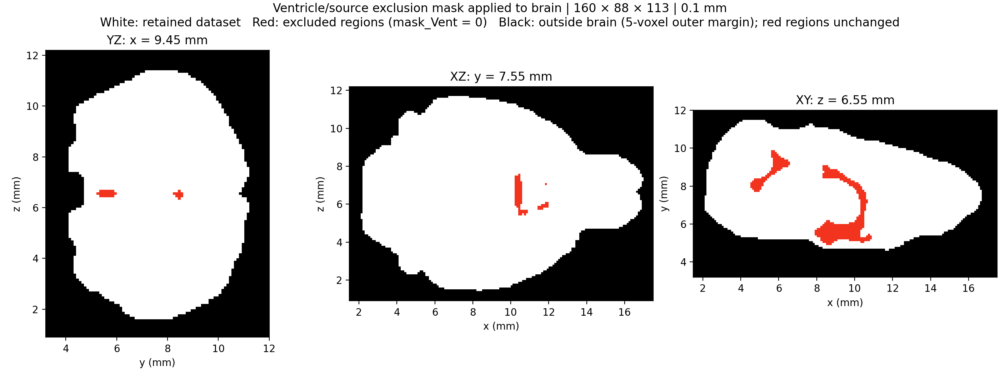
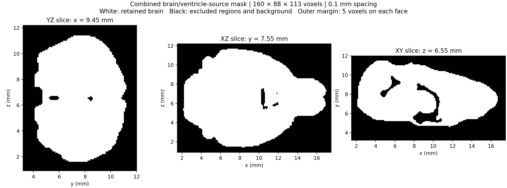

# C2V_brain: reconstructing velocity from concentration

**Which inverse method can most accurately and robustly recover a three-dimensional velocity field from time-resolved concentration data?**

This repository provides synthetic data generated by computational fluid dynamics (CFD) simulation in a whole brain-shaped computational domain. The primary goal is to reconstruct the velocity field **using concentration observations**, with the simulated velocity available as a reference for evaluation. Pressure and permeability reconstruction are secondary research objectives.

We welcome method proposals, reproducible implementations, and comparative studies. No best-performing method has been established yet; the purpose of this dataset is to support that investigation.

## The inverse problem

Given spatial locations, domain geometry, and concentration observations $c(\mathbf{x},t)$, estimate the velocity field $\mathbf{u}(\mathbf{x})=[u,v,w]$. The supplied CSVs contain one reference value of each velocity component per spatial location and a sequence of concentration snapshots.

The CFD output also includes diffusivity, permeability, and pressure. These fields make it possible to evaluate reconstruction against a known simulation reference. Their presence in the files does **not** mean they should automatically be used as inputs to a concentration-based inverse method.

For the primary comparison, use concentration and geometry as the observations, and reserve velocity, pressure, and permeability for evaluation. If a method additionally requires known diffusivity, boundary conditions, source information, material properties, or labeled training data, state those assumptions explicitly and report it as a separate configuration. Pressure and permeability recovery should be evaluated separately from the main velocity task.

## Dataset variants

All three CSVs describe the **same simulated case**. They are paired clean/noisy observations, not three independent simulations or a ready-made training/validation/test split.

| Variant | File | Purpose |
| --- | --- | --- |
| Clean | [Realistic_permeableTwoSource_noVent_structured.csv](Synthetic_data/Realistic_permeableTwoSource_noVent_structured.csv) | Reference concentration observations |
| Gaussian noise | [Realistic_permeableTwoSource_noVent_structured_Gaussian_Noisy10_seed42.csv](Synthetic_data/Realistic_permeableTwoSource_noVent_structured_Gaussian_Noisy10_seed42.csv) | Sensitivity to Gaussian measurement noise |
| Outlier noise | [Realistic_permeableTwoSource_noVent_structured_outlier_Noisy1_seed42.csv](Synthetic_data/Realistic_permeableTwoSource_noVent_structured_outlier_Noisy1_seed42.csv) | Robustness to sparse corrupted observations |

Each file contains **503,175 spatial rows and 100 columns**, including **91 concentration snapshots** labeled `c@t=0` through `c@t=90`. Numeric comparison confirms that the first nine columns, including coordinates and reference physical fields, are identical across the three files in the same row order.

The supplied overview labels Gaussian noise as **10%** and outlier noise as **2x**. The filenames carry `Noisy10`, `Noisy1`, and `seed42`. The noise-generation code is not included, so the normalization behind the percentage, exact outlier selection/amplitude rule, and clipping procedure still need documentation. Do not interpret these labels as a complete noise specification. Inspection also shows that **`c@t=90` is unchanged in both noisy files**; account for this when designing a robustness comparison.

### Figure 1. Concentration observations and reference fields



The supplied overview compares concentration at **5, 30, and 80 minutes** for the three observation variants (left). It also shows velocity magnitude, permeability, and field distributions (right and bottom), including comparisons labeled with and without ventricles. These additional figure comparisons do not imply that a separate ventricular CSV is included in this release. The preview is rendered from the [original visualization PDF](Synthetic_data/Synthetic_data_visualization.pdf).

## CSV fields and units

| Columns | Meaning | Units / interpretation |
| --- | --- | --- |
| `x(mm)`, `y(mm)`, `z(mm)` | Spatial coordinates | mm |
| `D(m^2/s)` | Diffusivity | m²/s |
| `k(m^2)` | Permeability | m² |
| `u(m/s)`, `v(m/s)`, `w(m/s)` | Reference velocity components | m/s |
| `p(Pa)` | Reference pressure | Pa |
| `c@t=0` … `c@t=90` | Concentration snapshots | Concentration units are not specified in the headers |

The overview uses minutes for its displayed times, but the CSV headers do not encode a time unit. Confirm the full time-axis convention before calculating temporal derivatives. Convert coordinates from mm to m when combining them with the SI-valued physical fields. The overview uses μm/s for velocity and mm² for permeability; the CSV uses m/s and m², respectively.

## Computational domain and masks

The three MATLAB files provide **related binary voxel masks on one common structured grid**, rather than three independent CFD meshes. Each contains a `mask` array of shape **160 × 88 × 113**, with axis order **x, y, z**, **0.1 mm** spacing, and five padding voxels on each face. Coordinate vectors are supplied as `x_mm`, `y_mm`, and `z_mm`.

| File | Meaning of the stored mask | Use |
| --- | --- | --- |
| [mask_brain.mat](Synthetic_data/mask_brain.mat) | `1` at original brain-domain locations, including ventricular/source regions; `0` outside or in padding | Original brain occupancy, 506,989 occupied voxels |
| [mask_Vent.mat](Synthetic_data/mask_Vent.mat) | `0` in excluded ventricular/source regions; `1` elsewhere, **including outside the brain** | Exclusion mask; combine with brain occupancy |
| [mask_brain_Vent.mat](Synthetic_data/mask_brain_Vent.mat) | Product of the two masks above | Retained domain for the supplied `noVent` data, 503,175 occupied voxels |

Use the combined mask for evaluation on the retained domain. Do not treat `mask_Vent` alone as brain occupancy. Map CSV coordinates to the supplied coordinate vectors instead of assuming that CSV rows can be directly reshaped into a dense volume. Excluded regions and padding are not measured zero-concentration samples.

Mask metadata refers to an original `Realistic_permeableTwoSource_Vent_structured.csv`; that source CSV is **not included** in this release.

### Figure 2. Original brain occupancy



White marks original dataset locations; black marks background and padding.

### Figure 3. Ventricular/source exclusions



Red marks excluded regions. This visualization applies the exclusion mask to the brain domain; the raw exclusion mask remains `1` outside the brain.

### Figure 4. Retained computational domain



White marks locations retained in the supplied datasets. Black includes background, padding, and excluded ventricular/source regions.

## Call for methods

We invite approaches that reconstruct velocity from the concentration sequence and explain the assumptions needed for recovery. These are candidate families for comparison, not an established ranking or a claim that every formulation is suitable for this dataset.

A useful contribution should answer:

1. **What information is required?** Specify observation times, geometry, physical coefficients, boundary/source information, and any training labels.
2. **What makes the reconstruction identifiable?** Explain the constraints or priors used and where the concentration observations may be insufficient to determine velocity reliably.
3. **How does the method handle noise?** Describe preprocessing, regularization, robust losses, and uncertainty estimation, if used.
4. **How well does it recover velocity?** Evaluate vector and component errors against the CFD reference, not only the fit to concentration.
5. **Can the result be reproduced?** Provide code, dependencies, configuration, random seeds, hardware, and runtime.

Please [open an issue](https://github.com/Vaezi92/C2V_brain/issues) to propose or discuss a method, or submit a pull request with a reproducible implementation and results. The repository is currently private; participation requires repository access.

## Proposed comparison protocol

This is a proposed reporting framework, not an already executed benchmark.

- **Run each observation variant separately.** Use the same retained domain and observation schedule. Report clean, Gaussian-noise, and outlier-noise results side by side.
- **Avoid paired-data leakage.** If a learned method uses labeled training cases, disclose their provenance. A clean/noisy pair from this simulation is not an independent test case. Define any spatial or temporal holdout explicitly and avoid claiming generalization to new simulations from this case alone.
- **Report velocity accuracy.** Include relative vector L2 error, component-wise RMSE, speed error, and error maps. For angular error, state a reference-speed threshold to exclude near-zero vectors. State whether spatial weighting is used.
- **Report physical and predictive checks.** Evaluate held-out concentration predictions when feasible, and residuals of the explicitly chosen governing equations. State the equations and boundary treatment; a small concentration residual alone is not the velocity-recovery metric.
- **Report practical cost and stability.** Include wall-clock time, hardware, peak memory if available, convergence criteria, and variation across optimization seeds. The supplied noisy datasets currently provide one named noise seed.
- **Keep secondary targets separate.** If estimating pressure or permeability, report their errors and additional assumptions. Specify any pressure reference/gauge alignment used in evaluation.

For sampled reference vectors $\mathbf{u}_i$ and reconstructed vectors $\widehat{\mathbf{u}}_i$, an unweighted relative vector error is

$$
E_{\mathbf{u}} = \frac{\sqrt{\sum_i \lVert\widehat{\mathbf{u}}_i-\mathbf{u}_i\rVert_2^2}}{\sqrt{\sum_i \lVert\mathbf{u}_i\rVert_2^2}}.
$$

Compute this over the declared evaluation mask and split. Report any alternative weighting or normalization. No quantitative method results are included yet.

## Download and load

The three CSVs are stored with **Git LFS**. Install [Git LFS](https://git-lfs.com/) before cloning, and authenticate with an account that has access to this private repository.

```bash
git lfs install
git clone https://github.com/Vaezi92/C2V_brain.git
cd C2V_brain
git lfs pull
```

The dataset files total approximately **1.58 GB** on disk; loading them into arrays can require substantially more memory. For inspection, read a subset or use chunked loading:

```python
from pathlib import Path
import numpy as np
import pandas as pd
from scipy.io import loadmat

root = Path("Synthetic_data")
frame = pd.read_csv(
    root / "Realistic_permeableTwoSource_noVent_structured.csv",
    nrows=1000,  # Inspection subset; omit or use chunksize for a full analysis.
)
c_columns = sorted(
    (name for name in frame.columns if name.startswith("c@t=")),
    key=lambda name: float(name.split("=")[1]),
)
xyz_m = frame[["x(mm)", "y(mm)", "z(mm)"]].to_numpy() * 1e-3
concentration = frame[c_columns].to_numpy()
time_labels = np.array([float(name.split("=")[1]) for name in c_columns])
# Confirm time units before converting these labels to physical time.
velocity_reference = frame[["u(m/s)", "v(m/s)", "w(m/s)"]].to_numpy()
# Keep velocity_reference separate from primary reconstruction inputs.

geometry = loadmat(root / "mask_brain_Vent.mat")
mask = geometry["mask"].astype(bool)  # Axis order: x, y, z.
axes_mm = [geometry[name].ravel() for name in ("x_mm", "y_mm", "z_mm")]
```

## Simulation metadata still to document

For reproducible physics-based inversion, the following details remain to be supplied or confirmed:

- Governing flow and transport equations, including any porous-medium formulation or advection-diffusion and the definition of velocity used in the export.
- Initial conditions, outer and internal boundary conditions, source locations and time profiles, and relevant material parameters.
- Concentration units and the full physical time-axis convention.
- CFD solver, numerical discretization, original mesh, and any interpolation used to produce the structured export.
- Exact noise-generation scripts and parameters, including the unchanged final concentration snapshot.
- A fixed evaluation split and agreed rules for known coefficients and reference-field use.
- Dataset license and preferred citation. No license or publication citation is supplied yet.

These details should be resolved before treating any method comparison as a definitive benchmark.
